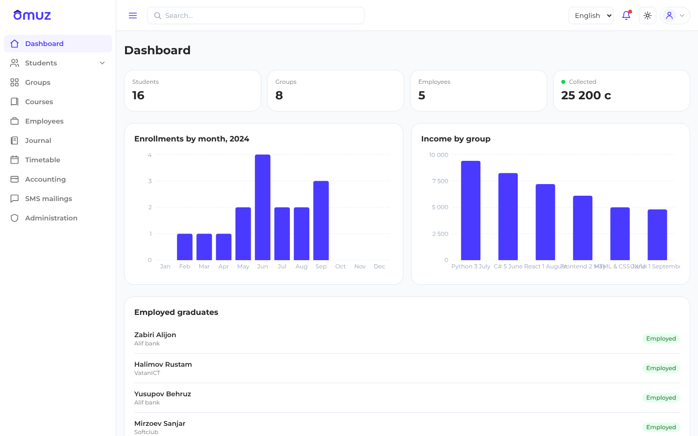
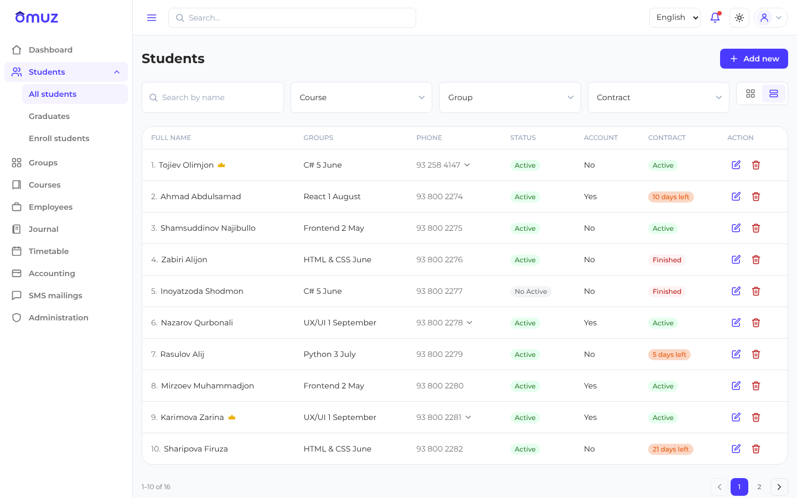
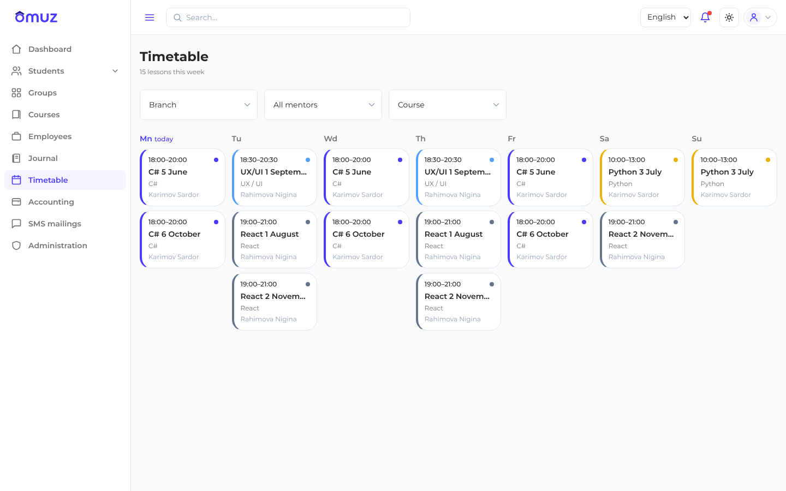
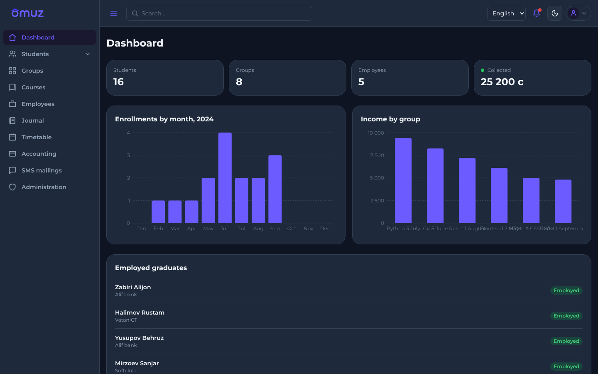
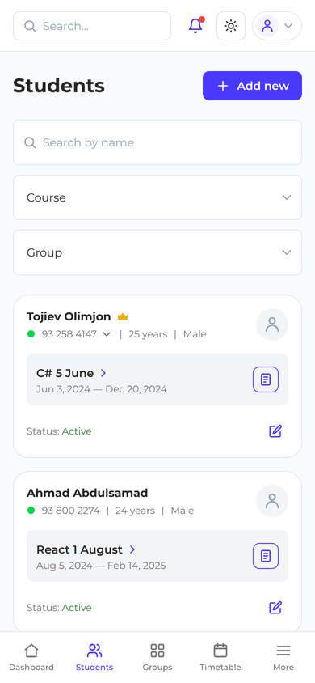

# Omuz CRM

CRM для учебного центра: студенты, группы, курсы, журнал посещаемости, расписание, оплаты, SMS-рассылки и администрирование. Интерфейс на трёх языках (русский, таджикский, английский), есть светлая и тёмная тема, вёрстка адаптивна от 360 px.

### [▶ Открыть демо](https://tolibovmuhamad.github.io/CRM/)

Вход в демо: телефон `+992 900 00 00 01`, пароль — любой. Данные в демо тестовые и хранятся только в браузере.




## Возможности

- **Студенты.** Список с поиском и фильтрами по курсу, группе и договору, добавление и редактирование, выпускники, запись на обучение. На телефоне таблица превращается в карточки.
- **Группы и курсы.** Группы по филиалам и статусам, курсы с расписанием, стоимостью и учебными материалами.
- **Журнал.** Посещаемость по датам занятий со сводкой «был / опоздал / не был».
- **Расписание.** Занятия на неделю с фильтрами по филиалу, ментору и курсу.
- **Бухгалтерия.** Оплаты со статусами и суммами в сомони.
- **Дашборд.** Графики набора по месяцам и дохода по группам, список трудоустроенных выпускников.
- **SMS-рассылки и администрирование.**
- **Роли.** Администратор, менеджер, ментор, разработчик и студент видят разные разделы меню.
- **Три языка и тёмная тема.** Переключаются на лету и запоминаются.

## Скриншоты

| Студенты | Расписание |
|---|---|
|  |  |

| Тёмная тема | Телефон |
|---|---|
|  |  |

## Демо-аккаунты

Пароль у всех — любой непустой. Роль определяет, какие разделы доступны.

| Телефон | Роль |
|---|---|
| `+992 900 00 00 01` | Администратор |
| `+992 900 00 00 02` | Менеджер |
| `+992 900 00 00 03` | Ментор |
| `+992 900 00 00 04` | Разработчик |
| `+992 900 00 00 05` | Студент |

## Как устроено

- **Feature-Sliced Design.** Слои `app → pages → widgets → features → entities → shared`, импорты только сверху вниз.
- **Единый интерфейс данных `CrmApi`** с двумя реализациями: моки и HTTP. Переключение — переменной `VITE_API_MODE`, компоненты не знают, откуда пришли данные. Моки отвечают с задержкой и умеют возвращать ошибку, поэтому у каждого экрана проверены состояния загрузки, пустого списка и ошибки.
- **Zod-схемы — единственный источник типов.** Каждый ответ проходит валидацию, типы руками не дублируются.
- **Деньги в дирамах.** Суммы хранятся целыми числами (1 сомони = 100 дирам), без ошибок округления.
- **Доступность.** Модалки ловят фокус и закрываются по Esc, у иконочных кнопок есть подписи, весь интерфейс проходится с клавиатуры.
- **Дизайн-токены** в `src/shared/styles/tokens.ts`, темы — через CSS-переменные.
- **114 тестов** на Vitest и Testing Library.

## Стек

React 18 · TypeScript (strict) · Vite · React Router · TanStack Query · Zustand · React Hook Form + Zod · Tailwind CSS · Recharts · i18next · date-fns · Vitest + Testing Library · ESLint + Prettier

## Запуск

```bash
npm install
cp .env.example .env   # при необходимости
npm run dev            # http://localhost:5173
```

## Команды

| Команда | Что делает |
|---|---|
| `npm run dev` | Дев-сервер Vite |
| `npm run build` | Проверка типов + прод-сборка |
| `npm run preview` | Предпросмотр прод-сборки |
| `npm run typecheck` | Проверка типов (`tsc -b`) |
| `npm run lint` | ESLint |
| `npm run format` | Prettier (запись) |
| `npm test` | Vitest (watch) |
| `npm run test:run` | Vitest (однократно); один файл — `npm run test:run -- src/shared/lib/money.test.ts` |

## Структура

`src/app` — вход, роутер, провайдеры · `src/pages` — экраны на роут · `src/widgets` — крупные блоки · `src/features` — действия пользователя · `src/entities` — сущности домена · `src/shared` — `ui` / `api` / `lib` / `i18n` / `styles` · `src/mocks` — фикстуры.

Подробности — в `TZ-omuz-crm.md` (ТЗ), `docs/` и `roadmap.md`.

## Деплой

Демо собирается и публикуется на GitHub Pages автоматически при каждом пуше в основную ветку (`.github/workflows/deploy.yml`).
